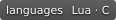

<div align="center">

[English](README.md) | [中文](README.zh.md)

<p align="center"> </p>

# Hello Lua

<p align="center">
  
  
  
  
</p>

Lua 开发者笔记 · [在线阅读](https://cuihairu.github.io/hello-lua/)

知识点总览 · [在线阅读](https://cuihairu.github.io/hello-lua/knowledge/README)

</div>

---

以游戏开发者分享视角记录 Lua 的学习笔记、心得与经验，涉及基础语法、进阶编程、语言设计与虚拟机实现、C 扩展、LuaJIT 和实践经验。

## 本地开发

```bash
npm install          # 安装依赖
npm run docs:dev     # 本地开发
npm run docs:build   # 构建到 docs/.vitepress/dist
npm run docs:preview # 本地预览构建产物
```

## License

本作品采用 [Creative Commons Attribution 4.0 International (CC BY 4.0)](https://creativecommons.org/licenses/by/4.0/) 许可协议发布。